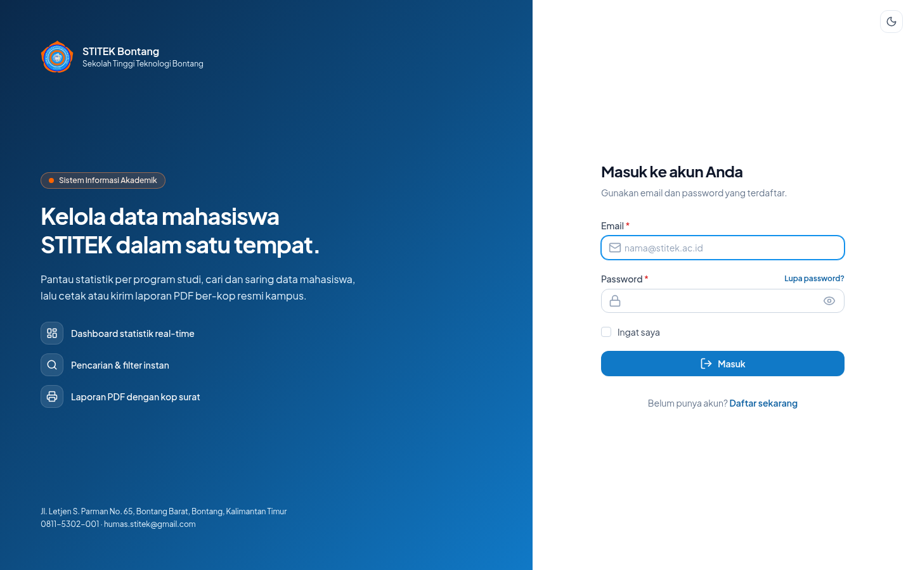
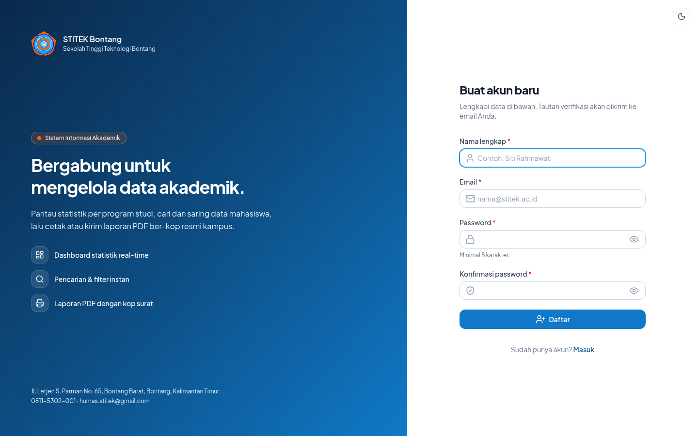
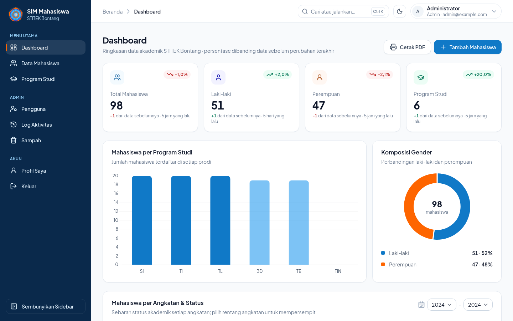
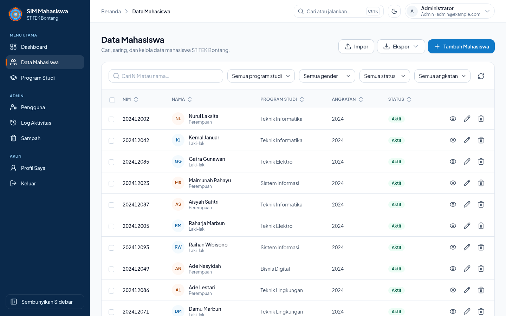
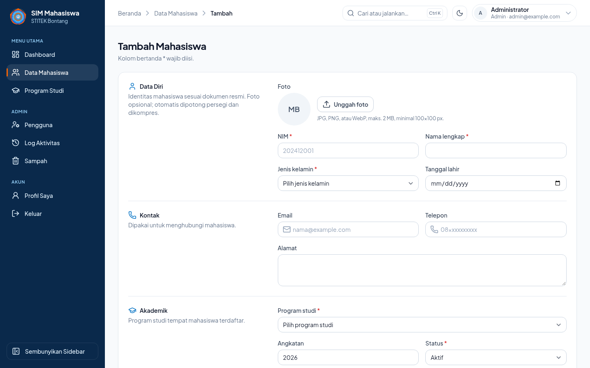
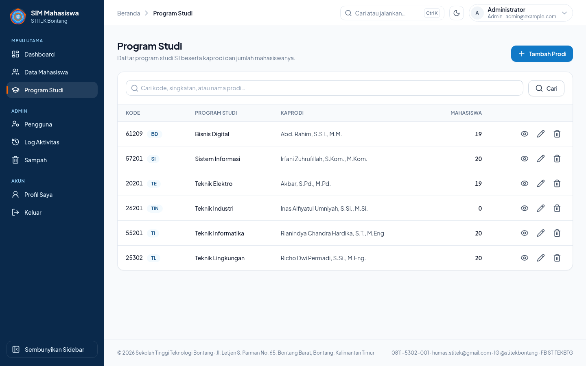
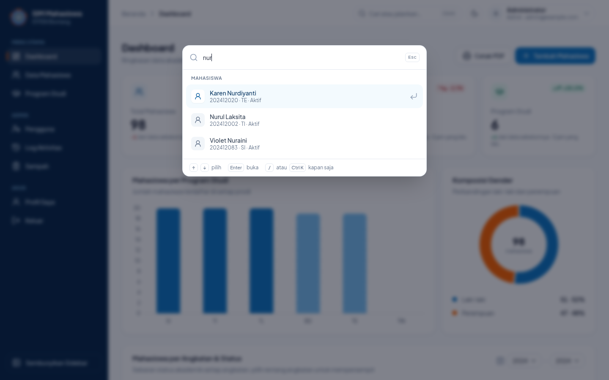
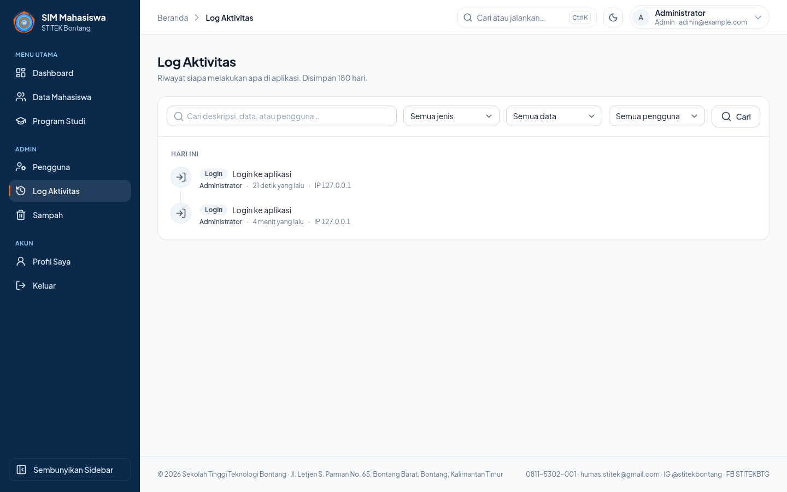
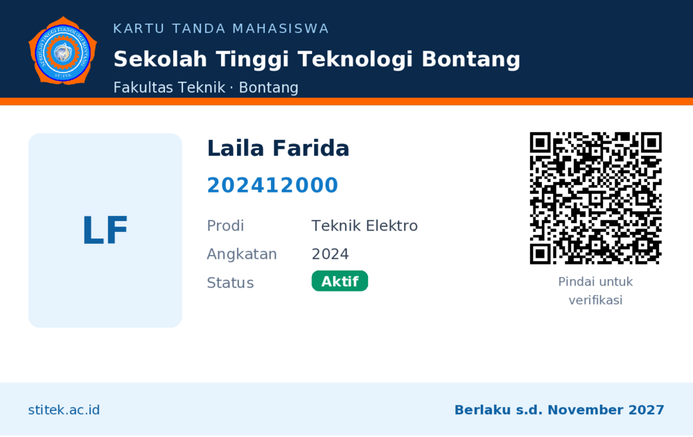
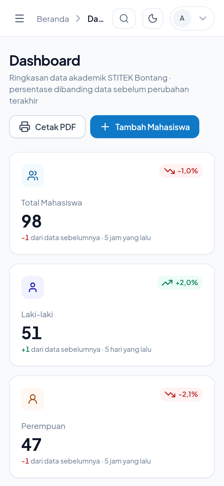

# SIM Mahasiswa — STITEK Bontang

Sistem informasi data mahasiswa dan program studi **Sekolah Tinggi Teknologi Bontang**, dikembangkan dari modul **Mini Project Laravel 11 — Sistem Informasi Data Mahasiswa** dan diperluas dengan fitur administrasi kampus.

```
Login → Dashboard → Data Mahasiswa (CRUD, pencarian, filter) → Program Studi → Profil → Logout
```

> **Status:** STEP 1–21 modul selesai, ditambah fitur lanjutan Prioritas A (role, Sampah, impor/ekspor, aksi massal) dan Prioritas B (log aktivitas, palet perintah Ctrl+K, grafik angkatan, kartu mahasiswa ber-QR).

---

## Anggota Kelompok

| No | Nama | NIM |
|----|------|-----|
| 1 | Taro | 202412023 |
| 2 | Firman | 202412012 |
| 3 | Zaldy | 202412040 |
| 4 | Ninda | 202412029 |
| 5 | Yovitha | 202412044 |

---

## Daftar Isi

1. [Teknologi](#teknologi)
2. [Progress Pengerjaan](#progress-pengerjaan)
3. [Fitur](#fitur)
4. [Instalasi](#instalasi)
5. [Panduan Perintah](#panduan-perintah)
6. [Role Pengguna](#role-pengguna)
7. [Pintasan Keyboard](#pintasan-keyboard)
8. [Struktur Database](#struktur-database)
9. [Route Utama](#route-utama)
10. [Performa](#performa)
11. [Screenshot](#screenshot)
12. [Catatan Pengerjaan](#catatan-pengerjaan)

---

## Teknologi

| Komponen | Teknologi | Keterangan |
|----------|-----------|------------|
| Framework |  | Modul memakai Laravel 11; kode kompatibel |
| Bahasa |  | Ekstensi: `pdo_pgsql`, `gd`, `zip`, `mbstring` |
| Database |  | `pg_trgm` untuk pencarian, RLS aktif di semua tabel |
| Tampilan |   | Komponen Blade sendiri, ikon Lucide inline, tanpa Bootstrap/CDN |
| Build |  | Font, ikon, dan Chart.js dibundel (Chart.js di-code-split) |
| Autentikasi | Laravel Breeze | Login, register, verifikasi email, lupa/reset password |
| PDF | `barryvdh/laravel-dompdf` | Laporan ber-kop resmi, biodata, kartu mahasiswa |
| Excel/CSV | `maatwebsite/excel` | Impor dengan pratinjau, ekspor sesuai filter |
| QR code | `chillerlan/php-qrcode` | QR verifikasi di kartu mahasiswa |
| Email | SMTP (Gmail) + queue `database` | Semua email dikirim lewat antrean |

**Palet warna** (diambil dari logo STITEK): primary `#1291EC`, secondary `#FE6500`, accent `#0000FD`, sidebar `#0A294B`.

---

## Progress Pengerjaan

| Step | Materi | Status |
|------|--------|--------|
| 1–3 | Project Laravel, database, konfigurasi `.env` | ✅ Selesai |
| 4 | Install Laravel Breeze | ✅ Selesai |
| 5–8 | Migration, model, seeder prodi, relasi | ✅ Selesai |
| 9–10 | Controller dan route | ✅ Selesai |
| 11–12 | Layout utama dan dashboard | ✅ Selesai |
| 13–14 | CRUD Program Studi dan Data Mahasiswa | ✅ Selesai |
| 15 | Dashboard dinamis (statistik + grafik) | ✅ Selesai |
| 16 | Sidebar + topbar + responsive | ✅ Selesai |
| 17 | Profil user + autentikasi | ✅ Selesai |
| 18 | Halaman login & register (split layout) | ✅ Selesai |
| 19 | Seeder + factory data dummy (`id_ID`, NIM `2024120xx`) | ✅ Selesai |
| 20 | Final polish UI (dark mode, aksesibilitas, responsif) | ✅ Selesai |
| 21 | Cetak PDF (daftar sesuai filter + biodata per mahasiswa) | ✅ Selesai |
| Prioritas A | Role, angkatan/status/foto, Sampah, impor/ekspor, aksi massal | ✅ Selesai |
| Prioritas B | Log aktivitas, palet perintah, grafik angkatan, kartu QR | ✅ Selesai |

---

## Fitur

**Dashboard**
- Kartu statistik total, laki-laki, perempuan, dan prodi. Persentase naik atau turun setiap ada satu data ditambah atau dihapus.
- Grafik mahasiswa per prodi, komposisi gender, dan rekap prodi dengan progress bar beserta nama kaprodi.
- Grafik **angkatan × status** dengan filter rentang angkatan. Filter diproses langsung di browser tanpa memuat ulang halaman.

**Data Mahasiswa**
- CRUD lengkap, termasuk foto (otomatis dipotong persegi dan dikompres ke WebP), angkatan, dan status (Aktif/Cuti/Lulus/Keluar).
- Pencarian live NIM/nama, filter prodi/gender/status/angkatan, dan sorting per kolom.
- **Aksi massal**: pilih beberapa baris, lalu ubah status, ekspor, cetak kartu, atau hapus.
- **Impor Excel/CSV** dalam 3 langkah (unggah → pratinjau kesalahan per baris → hasil), dilengkapi template dan laporan baris yang gagal.
- **Ekspor Excel/CSV** yang mengikuti filter aktif.
- **PDF** daftar mahasiswa (mengikuti filter, ditandatangani kaprodi atau Ketua STITEK) dan biodata per mahasiswa. Keduanya bisa dicetak atau dikirim ke email.
- **Kartu mahasiswa** ukuran kartu ATM dengan QR. QR membuka halaman verifikasi publik bertanda tangan (signed URL) yang menampilkan status kartu. Cetak massal menghasilkan 10 kartu per lembar A4.
- Riwayat aktivitas di halaman detail mahasiswa, termasuk nilai lama dan nilai baru setiap perubahan.

**Program Studi**: CRUD beserta kaprodi (nama asli, jabatan, NIDN/NUPTK). Prodi yang masih punya mahasiswa tidak bisa dihapus.

**Admin**
- **Pengguna**: ubah role atau hapus akun. Sistem mencegah admin menurunkan role dirinya sendiri dan menghapus admin terakhir.
- **Log Aktivitas**: mencatat siapa melakukan apa dan kapan, bisa difilter per jenis, data, dan pengguna. Log disimpan 180 hari.
- **Sampah**: data yang dihapus bisa dipulihkan atau dihapus permanen. Pemulihan ditolak bila NIM-nya sudah dipakai mahasiswa lain.

**Akun & email**
- Verifikasi email, lupa password, email selamat datang, dan notifikasi perubahan data ke admin. Semua email memakai tema STITEK dan dikirim lewat queue.
- Modal Profil dan Ganti Password dari dropdown topbar.

**Tampilan**: mode gelap, sidebar bisa diubah ke mode ikon saja, drawer di mobile, skip link, fokus terlihat, dan kontras AA.

---

## Instalasi

**Kebutuhan:** PHP ≥ 8.3 (dengan `pdo_pgsql`, `gd`, `zip`, `mbstring`), Composer, Node.js, dan project Supabase.

```bash
git clone https://github.com/Clarity69/SIM-MAHASISWA.git
cd SIM-MAHASISWA

composer install
npm install

cp .env.example .env
php artisan key:generate
```

### 1. Database Supabase

Ambil kredensial dari Supabase → **Connect** → **Session pooler**, lalu isi di `.env`:

```env
DB_CONNECTION=pgsql
DB_HOST=aws-0-<region>.pooler.supabase.com
DB_PORT=5432
DB_DATABASE=postgres
DB_USERNAME=postgres.<project-ref>
DB_PASSWORD=<password-database>
DB_SSLMODE=require
```

| Mode pooler | Port | Pengaturan tambahan |
|---|---|---|
| Session pooler (disarankan) | `5432` | Tidak ada. Koneksi persisten otomatis aktif (`DB_PERSISTENT`). |
| Transaction pooler | `6543` | `DB_EMULATE_PREPARES=true`. Koneksi persisten otomatis nonaktif. |

Session, cache, dan antrean disimpan lokal agar setiap halaman tidak perlu bolak-balik ke database:

```env
SESSION_DRIVER=file
CACHE_STORE=file
QUEUE_CONNECTION=database
APP_TIMEZONE=Asia/Makassar
APP_LOCALE=id
```

### 2. Email (Gmail SMTP)

Buat **App Password** di akun Google (Keamanan → Verifikasi 2 langkah → Sandi aplikasi), lalu isi:

```env
MAIL_MAILER=smtp
MAIL_HOST=smtp.gmail.com
MAIL_PORT=587
MAIL_USERNAME=emailkamu@gmail.com
MAIL_PASSWORD=<app-password-16-karakter>
MAIL_FROM_ADDRESS="emailkamu@gmail.com"
MAIL_FROM_NAME="SIM Mahasiswa STITEK"
```

`APP_URL` harus sama persis dengan alamat yang dibuka di browser (mis. `http://127.0.0.1:8000`). Tautan verifikasi email dan QR kartu memakai signed URL, jadi alamat yang berbeda akan menghasilkan error **403 Invalid signature**.

### 3. Migration, seeder, dan storage

```bash
php artisan migrate --seed   # tabel + 6 prodi STITEK + 100 mahasiswa + akun admin
php artisan storage:link     # agar foto mahasiswa bisa ditampilkan
```

### 4. Jalankan

```bash
composer run dev
```

Buka `http://127.0.0.1:8000`, lalu login dengan akun bawaan:

| Email | Password | Role |
|-------|----------|------|
| `admin@example.com` | `password123` | Admin |

> ⚠️ Jangan commit file `.env` (sudah ada di `.gitignore`), karena berisi password database dan email.

---

## Panduan Perintah

### Sehari-hari

| Perintah | Fungsi |
|---|---|
| `composer run dev` | Menjalankan **semua** proses pengembangan sekaligus: web server, **queue worker** (pengirim email), log viewer (`pail`), dan Vite (hot reload CSS/JS). Hentikan dengan `Ctrl+C`. |
| `php artisan serve` | Web server saja, tanpa queue (email tidak terkirim). |
| `php artisan queue:work` | Worker antrean saja. Wajib berjalan agar email verifikasi, reset password, notifikasi, dan PDF via email terkirim. |
| `npm run build` | Build asset produksi ke `public/build`. |

### Akun dan role

| Perintah | Fungsi |
|---|---|
| `php artisan user:role <email> admin` | Menjadikan akun sebagai **admin**. |
| `php artisan user:role <email> operator` | Menurunkan akun menjadi **operator**. |

Akun yang mendaftar sendiri otomatis menjadi operator. Admin juga bisa mengubah role lewat menu **Pengguna**.

### Email

| Perintah | Fungsi |
|---|---|
| `php artisan mail:test <email>` | Kirim email uji untuk mengecek konfigurasi SMTP. Pesan error ditampilkan tanpa membocorkan password. |
| `php artisan queue:failed` | Melihat email/job yang gagal. |
| `php artisan queue:retry all` | Mengulang semua job yang gagal. |

### Database

| Perintah | Fungsi |
|---|---|
| `php artisan migrate` | Menjalankan migration baru. |
| `php artisan db:seed` | Mengisi ulang data awal (prodi, mahasiswa contoh, admin). |
| `php artisan migrate:status` | Melihat migration yang sudah atau belum dijalankan. |
| `php artisan model:prune` | Menghapus log aktivitas yang lebih tua dari 180 hari. |
| `php artisan schedule:work` | Menjalankan tugas terjadwal (prune log harian) di lokal. Di server, cukup tambahkan cron `* * * * * php artisan schedule:run`. |

### Testing dan kualitas kode

| Perintah | Fungsi |
|---|---|
| `php artisan test` | Menjalankan seluruh test (117 test). Membutuhkan ekstensi `pdo_sqlite` karena test memakai SQLite in-memory. |
| `php artisan test --filter=KartuMahasiswaTest` | Menjalankan satu kelompok test saja. |
| `vendor/bin/pint` | Merapikan format kode PHP. |
| `npm run icons` | Membuat ulang `resources/icons/lucide.php` setelah menambah ikon di `scripts/build-icons.mjs`. |

### Produksi

```bash
composer install --no-dev --optimize-autoloader
npm ci && npm run build
php artisan migrate --force
php artisan storage:link
php artisan optimize          # config:cache + route:cache + view:cache + event:cache
php artisan queue:work --tries=3   # jalankan lewat supervisor/systemd
```

Setelah mengubah `.env` atau config di server, jalankan `php artisan optimize:clear`, lalu `php artisan optimize` lagi.

---

## Role Pengguna

| Fitur | Operator | Admin |
|---|:---:|:---:|
| Dashboard, CRUD mahasiswa, impor/ekspor, aksi massal, PDF, kartu | ✅ | ✅ |
| Tambah/ubah prodi | ✅ | ✅ |
| Hapus prodi | — | ✅ |
| Kelola pengguna, Log Aktivitas, Sampah | — | ✅ |
| Email notifikasi perubahan data | — | ✅ (bisa dimatikan di Profil) |

---

## Pintasan Keyboard

| Tombol | Fungsi |
|---|---|
| `Ctrl` + `K` (`⌘` + `K` di Mac) atau `/` | Buka palet perintah: cari mahasiswa/prodi, pindah halaman, aksi cepat |
| `↑` `↓` lalu `Enter` | Pilih dan buka hasil di palet perintah |
| `Esc` | Tutup palet, modal, atau drawer |

---

## Struktur Database

```
prodis (1) ──< mahasiswas >── (0..1) users (deleted_by)
users  (1) ──< activity_logs
```

| Tabel | Kolom penting |
|---|---|
| `prodis` | `kode_prodi` (unik), `singkatan`, `nama_prodi`, `fakultas`, `kaprodi`, `kaprodi_jabatan`, `kaprodi_nidn` |
| `mahasiswas` | `nim` (unik selama belum dihapus), `nama`, `jenis_kelamin`, `tanggal_lahir`, `alamat`, `telepon`, `email`, `prodi_id`, `angkatan`, `status`, `foto`, `deleted_at`, `deleted_by` |
| `users` | `name`, `email`, `role` (`admin`/`operator`), `notify_mahasiswa_changes`, `email_verified_at` |
| `activity_logs` | `user_id`, `user_name`, `event`, `subject_type`, `subject_id`, `subject_label`, `description`, `properties` (JSON), `ip_address`, `created_at` |

Tabel bawaan Laravel lain yang dipakai: `password_reset_tokens`, `sessions`, `cache`, `jobs`, `failed_jobs`.

Index yang ditambahkan:
- `(prodi_id, jenis_kelamin)`, `created_at`, `angkatan`, `status`.
- GIN trigram pada `nama` dan `nim` untuk pencarian `ILIKE`.
- Unique parsial `nim WHERE deleted_at IS NULL`.
- Index foreign key `deleted_by` dan `activity_logs.user_id`.

Semua tabel memakai **RLS tanpa policy**, sehingga tidak bisa diakses lewat Data API Supabase (anon key). Laravel tetap bisa mengaksesnya karena terhubung sebagai pemilik tabel.

---

## Route Utama

| Method | URL | Nama | Keterangan |
|---|---|---|---|
| GET | `/dashboard` | `dashboard` | Dashboard |
| GET | `/cari?q=` | `search` | Pencarian palet perintah (JSON) |
| — | `/mahasiswa/...` | `mahasiswa.*` | CRUD (resource) |
| GET | `/mahasiswa/pdf` | `mahasiswa.pdf` | PDF daftar sesuai filter |
| GET | `/mahasiswa/{id}/pdf` | `mahasiswa.pdf.show` | PDF biodata |
| GET | `/mahasiswa/{id}/kartu` | `mahasiswa.kartu` | Kartu mahasiswa (PDF) |
| GET | `/kartu/verifikasi/{id}?signature=` | `kartu.verifikasi` | Verifikasi kartu dari QR (publik, signed) |
| POST | `/mahasiswa/aksi-massal` | `mahasiswa.bulk` | Hapus, ubah status, ekspor, atau cetak kartu |
| GET | `/mahasiswa/export` | `mahasiswa.export` | Ekspor Excel/CSV |
| GET/POST | `/mahasiswa/import...` | `mahasiswa.import.*` | Wizard impor |
| — | `/prodi/...` | `prodi.*` | CRUD (resource) |
| GET | `/pengguna` | `users.index` | Kelola pengguna (admin) |
| GET | `/aktivitas` | `activity.index` | Log aktivitas (admin) |
| GET | `/sampah` | `trash.index` | Sampah (admin) |
| GET | `/profile` | `profile.edit` | Profil, keamanan, notifikasi |

Daftar lengkap bisa dilihat dengan `php artisan route:list --except-vendor`.

---

## Performa

Database berada di Supabase **Seoul**, sehingga setiap query ke sana memakan 0,1 detik sampai beberapa detik, tergantung jaringan. Karena itu optimasinya berfokus pada **mengurangi jumlah perjalanan ke database**:

| Halaman | Sebelum | Sesudah |
|---|---|---|
| Dashboard | 7 query, 0,7–4,8 dtk | **0 query** saat cache hangat, ±0,03 dtk |
| Data Mahasiswa (pindah halaman/filter) | 3 query, 1–7 dtk | 1 query (data + prodi + total digabung). Saat cache hangat atau sudah di-prefetch: 0,04–0,09 dtk |
| Pencarian | `LIKE` (case-sensitive, "nur" tidak menemukan "Nurul") | `ILIKE` + index trigram |
| Log aktivitas | — | Disimpan dengan satu INSERT setelah respons terkirim (`defer`), jadi tidak menambah waktu tunggu |

Teknik yang dipakai:
- Session dan cache disimpan di file lokal.
- Data user login dan daftar prodi disimpan di cache.
- Cache per halaman/filter dengan *versioning*, otomatis usang saat data berubah.
- Prefetch saat kursor diarahkan ke link, ditambah *speculation rules* (prerender).
- Koneksi PDO persisten.
- Chart.js di-code-split.
- `preventLazyLoading` di luar produksi agar N+1 query langsung ketahuan.

Detail `EXPLAIN ANALYZE` sebelum/sesudah index ada di [`docs/performance.md`](docs/performance.md). Jika aplikasi dipakai di Indonesia, memindahkan project Supabase ke region **Singapura** akan mempercepat halaman yang baru pertama kali dibuka.

---

## Screenshot

| Halaman | Screenshot |
|---------|------------|
| Login |  |
| Register |  |
| Dashboard |  |
| Data Mahasiswa |  |
| Tambah Mahasiswa |  |
| Program Studi |  |
| Palet perintah (Ctrl+K) |  |
| Log Aktivitas |  |
| Kartu Mahasiswa |  |
| Tampilan Mobile |  |

---

## Catatan Pengerjaan

- Modul ditulis untuk **Laravel 11 + MySQL**, sedangkan project ini memakai **Laravel 13 + Supabase PostgreSQL**. Pencarian memakai `ILIKE` agar tidak membedakan huruf besar/kecil.
- Bootstrap dari CDN diganti Tailwind + Alpine dengan komponen Blade (`x-button`, `x-card`, `x-input`, `x-modal-confirm`, dll.), sehingga semua asset dibundel Vite dan tidak bergantung pada CDN.
- Validasi dipindah ke Form Request (`MahasiswaRequest`, `ProdiRequest`) agar dipakai bersama oleh `store` dan `update`.
- Data kaprodi memakai nama asli (sumber: repo lama, situs stitek.ac.id, dan konfirmasi kelompok), bukan nama dummy. Kop surat memakai data resmi Yayasan Pendidikan Bessai Berinta.
- Hapus mahasiswa memakai *soft delete* (masuk Sampah). Foto baru ikut dihapus saat data dihapus permanen.
- Laravel 13 menolak menyimpan objek ke cache (`cache.serializable_classes = false`), sehingga cache hanya berisi array dan model dibuat ulang setelah dibaca.
- Log aktivitas hanya dicatat untuk aksi pengguna yang sedang login. Seeder dan perintah konsol tidak tercatat.
